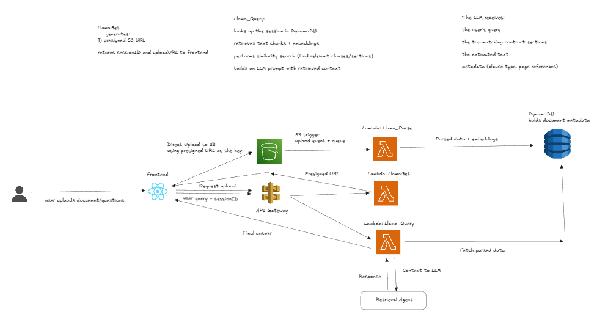

# Lens

A serverless document analysis tool that lets users upload legal contracts and ask questions about them using retrieval-augmented generation. Built on AWS Lambda, DynamoDB, S3, and OpenAI.

## System Design



The source diagram lives in [`docs/architecture.excalidraw`](docs/architecture.excalidraw), which you can open at [excalidraw.com](https://excalidraw.com).

The system is split into three Lambda functions connected by S3 events and API Gateway:

**LlamaGet** handles session creation. When a user uploads a file, the frontend requests a presigned S3 URL and a new session ID. The PDF is uploaded directly from the browser to S3, keeping Lambda out of the data path.

**LlamaParse** is triggered automatically by the S3 upload event. It downloads the PDF, extracts text, splits it into overlapping chunks using recursive hierarchical separators, generates vector embeddings for each chunk via OpenAI, and stores everything in DynamoDB. Once done, it marks the session as ready for queries.

**LlamaQuery** handles the question-answering flow. It embeds the user's question, retrieves all stored chunks for that session, ranks them by cosine similarity, selects the most relevant ones, and sends them to the LLM with a legal analysis prompt. The response is returned along with latency metrics.

Storage is split between S3 for raw PDFs and DynamoDB for session metadata, text chunks, and embedding vectors. All external communication goes through API Gateway over HTTPS.

## Project Layout

```
backend/     one folder per Lambda function, plus the pytest suite
frontend/    React app (Create React App)
docs/        architecture diagram and its Excalidraw source
samples/     sample contract for manual testing
scripts/     chunking comparison and live evaluation scripts
template.yaml  SAM template for the whole stack
```

## Getting Started

### Frontend

```bash
cd frontend
npm install
npm start
```

The dev server starts at [http://localhost:3000](http://localhost:3000). API endpoints are configured in `frontend/.env`.

### Backend

Each Lambda function lives in `backend/` and needs to be packaged with its dependencies before deploying to AWS:

```bash
# LlamaGet only uses boto3, which Lambda already provides

# LlamaParse
pip install -r backend/LlamaParse/requirements.txt -t backend/LlamaParse

# LlamaQuery
pip install -r backend/LlamaQuery/requirements.txt -t backend/LlamaQuery
```

### Deploying

`template.yaml` is a SAM template that creates everything the functions need: the
upload bucket, the sessions and chunks tables, the three functions with their IAM
roles, the API Gateway routes, and the S3 event notification on the `uploads/` prefix.

```bash
sam build
sam deploy --guided
```

It prompts for the bucket name and the OpenAI key, then outputs `ApiBaseUrl` to use as
`REACT_APP_API_BASE` in the frontend.

### Environment Variables

Set these in the Lambda console for each function:

| Function | Variables |
|----------|-----------|
| LlamaGet | `BUCKET_NAME`, `TABLE_NAME` |
| LlamaParse | `BUCKET_NAME`, `SESSIONS_TABLE`, `CHUNKS_TABLE`, `OPENAI_API_KEY` |
| LlamaQuery | `SESSIONS_TABLE`, `CHUNKS_TABLE`, `OPENAI_API_KEY` |

## Tests

The frontend components run under jest and React Testing Library:

```bash
cd frontend
npm test
```

The chunking, retrieval, and query handler logic is covered by pytest. AWS and OpenAI
clients are stubbed, so no credentials or API key are needed:

```bash
pip install -r backend/requirements-dev.txt
python -m pytest backend/tests
```

## Usage

1. Start the frontend and open it in a browser
2. Upload a PDF using the file input
3. Wait for the status badge to show "Ready"
4. Click on the file in the sidebar to view it
5. Ask questions about the document in the chat panel
